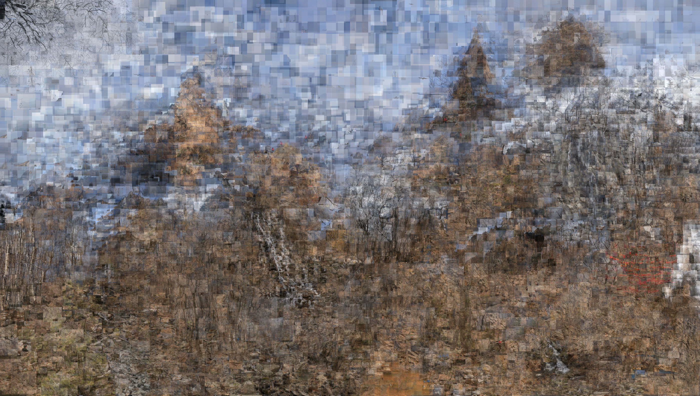
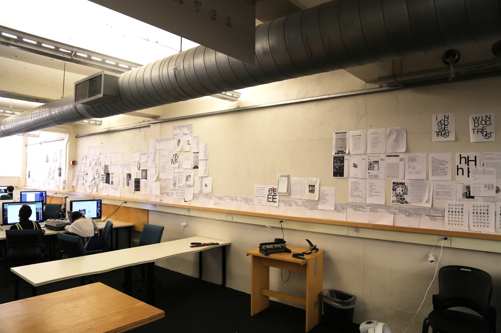
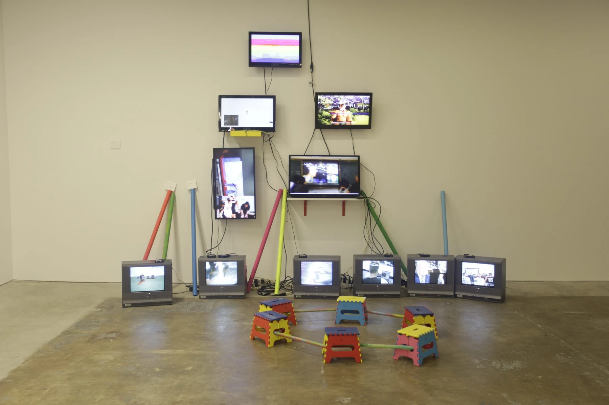
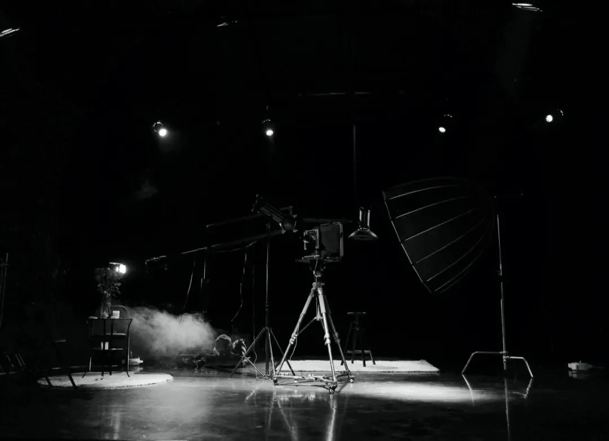
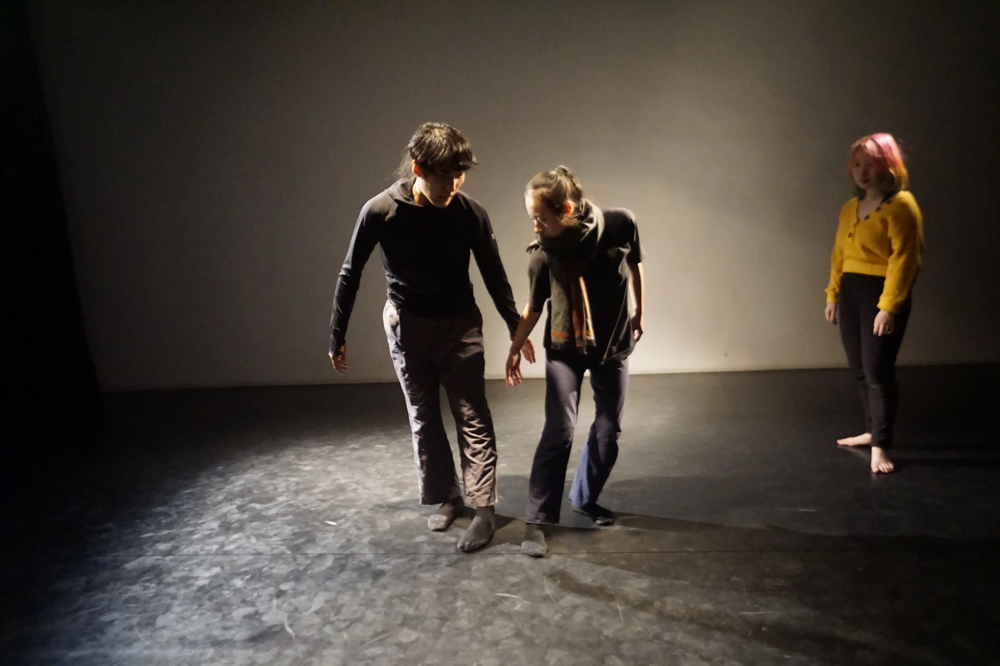
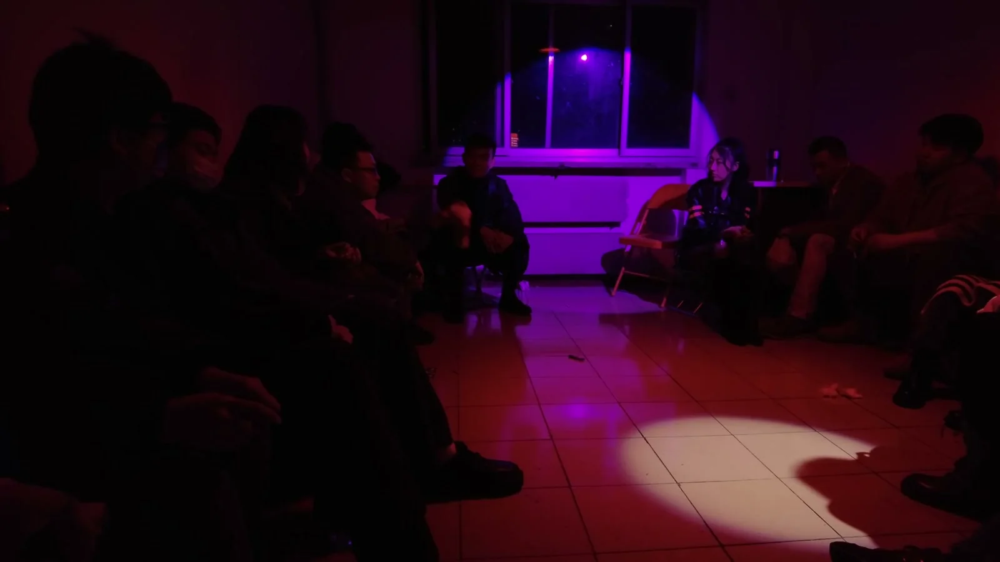
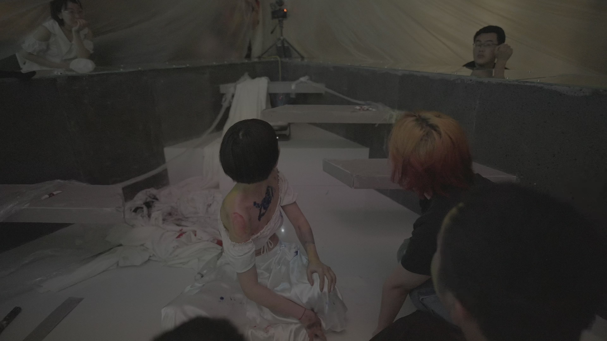
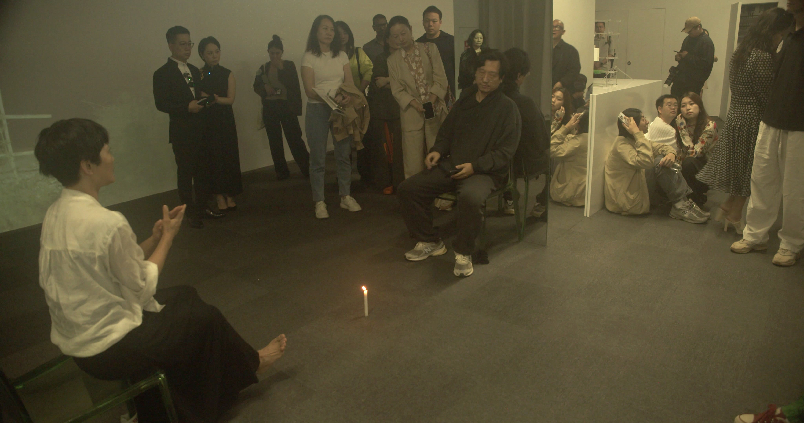

# 悬置的断头台

论何发艺术实践中的装置症候、对抗美学与档案地形学

岑照

## 摘要

何发的摄影、语言实验、P4剧场与电影实践，始终围绕一项极具危险性的核心工作展开：精心布设一套让人们相遇的严苛条件，再将作者自身与作品一并抛入这些条件所引出的对抗性回应之中。本文通过引入米歇尔·福柯与乔治·阿甘本的“装置（Dispositif）”哲学、克莱尔·毕晓普的“对抗性关系美学”、雅克·朗西埃的“感性分配”以及雅克·德里达的“档案热病”，与何发的具体作品相互对读。文章从《山重水复》《Fafalish》《YourTube》《实像》及P4的集体制作出发，剖析图像的知识考古接缝、次文化编码的排他性以及合作契约中的劳动分配；继而通过与让·鲁什“真实电影”及皮兰德娄元戏剧的比较，直刺《人类投降派》中“现场造反”与“剪辑主权”之间的惊险拉锯。《关系生成影像论》、回顾性影像随笔及数字档案被放回各自真实的历史版本与权力摩擦中。本文主张，评价这组实践不能依赖“生成”或“非主权”的先验理论豁免，而必须考察形式如何组织经验、合作怎样分配负担，以及不同意见是否真正具备让庞大的艺术机器当场停摆的力量。

## Abstract

He Fa's work in photography, language experiments, P4 Theater, and experimental cinema repeatedly involves arranging rigorous conditions for an encounter and working with the antagonistic responses those conditions produce. Situating He Fa within a comparative theoretical coordinate system—drawing on Foucault and Agamben's philosophy of the dispositif (apparatus), Claire Bishop's critique of relational aesthetics, Jacques Rancière's "distribution of the sensible," and Jacques Derrida's Archive Fever—this essay examines photographic seams, viewing positions, and participants' decision-making through Shanshui, Fafalish, YourTube, Real Image, and P4's collaborative productions. It then contrasts Shoot Self with You with Jean Rouch's cinéma vérité and Pirandellian metatheatre to examine the tension between live openness and editorial sovereignty. Relational Image Theory, retrospective video essays, and digital archives are assessed in relation to their specific versions and uses. The essay argues that these practices must be judged by the experience their forms produce, the distribution of collaborative labor, and the capacity of disagreement to bring the artistic machine to a halt.

## 序论：作为“装置（Dispositif）”的针孔与拒斥的政治

在《一个孔如何成为剧场》中，何发从亲手制作针孔相机的物理经验写起：封死盒子，留下小孔，让外面的光在黑暗内部形成图像。他用一句极简却冷酷的断语概括这个做法：“想看见，先得让大部分光进不来。”[1]

乔纳森·克拉里在《观察者的技术》中，把暗箱从透明的真理隐喻放回了观察者的历史。何发则从封盒、遮光与开孔的手工动作，重新摸到这套观看秩序的边缘：暗箱首先得挡住什么，才可能让什么显现？摄影师框定照片的边缘，装置作者安排屏幕与座位的距离，剧场组织者排定房间、工期和共同任务——画面尚未浮现，观看的条件早已落地。[19]

这里可以借用“装置（dispositif）”来理解这组动作。沿着福柯对异质关系网络的追问，阿甘本把装置扩展到能够捕获、引导和塑造生命举止的机制。房间、镜头、邀请与规则并不独立地工作；它们织成一张网，在人开口以前，先替开口划出位置。[20]

然而，何发并非一个满足于打造精密装置的冷血工程师。他的全部戏剧性与危机感，来自于当“活生生的人”走进装置的那一刻，预设的几何学开始变得极不稳定：照片可以被移动，被拍的人会突然提出反要求；椅子明明可以连成一圈，坐在上面的人却未必愿意交谈；哪怕一个人得到了“导演”的称谓，他在失控的现场也未必自动获得改变局面的能力。何发最值得被严肃讨论的工作，恰恰发生在这些“装置的预设安排”与“肉身的现场回应”迎头相撞、彼此抵触的断层线上。

在当代艺术批评中，存在着一种懒惰的浪漫主义倾向——动辄将此类实践赞美为一场不断走向胜利的“去中心化”或“主权让渡”。这种廉价的赞美反而抹平了作品内部最真实的摩擦。在何发的实践里，艺术家从未因为承认摄影机在场而交出取景权，开放的排练场也从未自动废除后期的剪辑台。批评的任务，不是替艺术家颁发一张“非主权”的道德免罪金牌，而是像法医一样去精准辨认：在不同的项目里，他究竟把哪些决定权交给了别人，又把哪些底牌死死攥在自己手里？当权力的拉锯发生时，作品的形式究竟留下了怎样的咬痕？

## 一、接缝的认识论：恋物癖分裂、巴别塔故障与次文化暗码

在进入剧场与真人肉搏之前，何发首先在图像、语言与屏幕装置中，对“无缝的总体性（Seamless Totality）”发起了三次漂亮的狙击。

### 1. 《山重水复》：明知而仍然相信的双重目光

图1｜何发，《山重水复——红》，2012，数字摄影拼贴。完整画面。 [图像出处](https://hefa.p4theater.cn/images/hf-img-e24ccd4601c1)

在中央美术学院美术馆馆藏的摄影拼贴《山重水复》中，何发保留了一个无法被视觉迅速消化的矛盾。远观时，山体、天空与树林顺从地组成连贯的风景；走近以后，局部照片的边缘又把这个整体拆开。眼睛前脚刚承认一座山的整体，后脚就持续踢到它被人工拼接的痕迹——画面拒绝把制作过程藏到风景背后。[2]

这不能被简单概括为一句“摧毁上帝视角”，因为观众依然可以退后，依然可以把照片当作一幅完整的山水来欣赏。作品真正的张力，来自两种观看模式无法完全重合：整体带来连贯的抚慰，局部则标出连贯所付出的代价——所谓的“完整”，不过是许多并不天然吻合的片段彼此迁就的结果。观看因此被迫在逼近与后退之间反复调整，甚至在调整中获得一种奇异的快感。

曼诺尼关于“我知道，但即便如此”的讨论，为这种双重目光提供了一条侧路。眼睛认出了接缝，却没有因此离开风景。借来的只是这一句式的张力，并非给观众作精神分析诊断，也不是把经过制作的图像简单判为虚假。[21]

如果接缝仅仅为了证明“图像皆虚假”，作品很快就会沦为摄影不可靠的枯燥说明。《山重水复》更有分量的地方，在于眼睛明知图像经过拼接，却依然愿意坠入其中。它保留图像的魅惑，又把制造魅惑的针脚翻到表面。连贯已经发生，裂缝却没有愈合；何发对媒介的投入，也经常悬在这两种力量之间。

### 2. 《Fafalish》：一门语言在自己内部出走

图2｜何发，《Fafalish》，2017，CCA Simpson Library，旧金山。图片：CCA/C Archives，CC BY-NC 4.0。 [许可](https://creativecommons.org/licenses/by-nc/4.0/) [图像出处](https://hefa.p4theater.cn/images/hf-img-6b2a8de2b7b8)

到了《Fafalish》，这道接缝被移入了语言。公开展览资料记录了一条从毛泽东《念奴娇·昆仑》出发的连续转换路径：宏大的诗句经逐字英译、带口音的朗读、拼音听写、汉字重写，再进入机器英译。上一环的偏差直接成为下一环必须面对的材料，文本、声音与字形之间，没有任何一项可以稳定地充当统领全局的暴君。[3]

误译当然未必带来自由。一个人说不准确，也可能因此更难被听见。德勒兹与瓜塔里的“少数文学”讨论的是对大语言的异化使用，以及个人表达如何触及政治和集体发言；口音与误写不会自动取得这张通行证。[22]

把两者对读，《Fafalish》的力量落在转换所留下的阻力上：一句原本气魄宏大的诗句怎样失去节奏，声音怎样被听写成走样的文字，纸面又怎样绊住眼睛。口音、猜测与迟疑已经进入作品。语言没有先把自己修好，再请求别人倾听。

### 3. 《YourTube》：次文化编码与“连接”的幻觉

图3｜何发，《YourTube》，2018，多屏影像装置。墙面屏幕、地面CRT与相连的六张矮凳。 [图像出处](https://hefa.p4theater.cn/images/hf-img-c9233c4c6038)

而在多屏装置《YourTube》中，被重新安排的是已经经过他人观看与包浆的网生影像。装置中，六台显像管电视沿地面展开，平板屏幕向墙面延伸；彩色管材把六张矮凳连接成环。这里藏着一个极度拧巴的空间结构：屏幕形成可辨的正面，座位却围出另一个中心；使身体聚拢的物理结构，与吸引目光的视觉方向在空间中根本无法重合。[4]

依据现存创作来源说明，屏幕中的影像涉及男性同性情色材料，以及网络“哲学”文化对这些材料的二次创作。这里的“哲学”属于特定网络社群的内部称呼，绝不能直接等同于学院里的哲学学科。屏幕里密集的弹幕、空耳和再剪辑，使观看带着先前观看者留下的厚重痕迹：某个身体动作尚未被展厅里的当前观众理解，社群的玩笑与解释已经在画面里等候。

这构成了一个绝佳的文化社会学切片：我们既可以讨论边缘欲望怎样借助次文化黑话公开现身，也可以讨论同一套高度排他的暗号怎样把不熟悉它的人拒之门外。现场照片留下了座位、身体与屏幕，却不替每一位观众交出内心。画面中已有的弹幕，也不等于展厅里的人能够把自己的话写进去。

《YourTube》由此把一个针对数字时代的批判命题做得极其清楚：连接（Connection）可以提前完成，关系（Relation）却仍须当场发生。 电线接通了设备，管材接上了凳子，影像保存了他人的反应；但这些物质与数据的连接，并没有替坐下来的人完成理解。艺术家提供了一个物理位置，这个位置能否被使用、被重新解释，甚至被改变，是作品继续承受的问题。

从摄影接缝到语言转换，再到多屏与座位，这些早期作品各有其具体的历史和质感。《Fafalish》的口音不必被解释为后来电影的预告，《山重水复》的拼接也无须预先服从一套多年后才写出的理论。批评的回看可以建立关系，但不能替过去补上一份从未存在的总计划。

## 二、对抗性关系美学：契约的边界与合作的账单

伯瑞奥德的“关系美学”把艺术中的相遇与交往推向前景。毕晓普随后追问，这些关系为谁而设，又排除了谁；共同待在一个房间里，不能独自成为民主的证明。“对抗”在这里也不以争吵的音量计分。真正尖锐的，是共处无法掩盖的差异，以及差异能否撼动已经摆好的位置。[23]

把《实像》与P4放在这个问题旁边，它们的锋芒便不只来自现场的强度。一张照片可以不公开，一场戏仍有制作与发行的边界；那些平时躲在作品背后的条款，开始抵住作品自己的咽喉。

### 1. 《实像》：将“不公开”写入摄影契约

图4｜《实像》，2019—2020，舞台工作记录。张绍华与何发共同推进；图片：P4剧场。 [图像出处](https://hefa.p4theater.cn/images/hf-img-f0c337e08939)

2019 年开始的《实像》把摄影的时间延伸到了照片完成以后。在 2020 年的公开说明中，这一实践被组织为“八幕半”：奇数幕以拍摄为主，偶数幕转向照片的观看与表达；上一场拍摄留下的图像，成为下一次会面的材料。张绍华与何发共同推进这一工作，何发当时将自己的参与说明为理论、结构、框架与解读。[5]

这个结构彻底改变了肖像的交付方式。被拍的人需要再次面对已经留下的自己，可以认同，也可以感到陌生；摄影师则无法指望靠一次快门把人固定在一个最终版本里。会面继续进行，照片却保留着上一时刻的形状，二者之间的时间落差成为了作品的本体。

更重要的是原始说明中的一项明确约定：参与者可以决定照片是否公开。 这项约定使作品在制度上允许一种“不便于展示”的结果——过程已经真实发生，个人影像却不必向陌生人开放。对于以肖像为材料的项目，这项决定直接卡住了作品以什么形式进入公共领域的咽喉。

门并没有因此全部打开。现场怎样继续，材料如何保存，后来的解释又怎样形成，仍各有自己的门槛。如果把一项具体的公开决定权夸大为“全面平等”，不仅会削弱这项权利原本的分量，也会使那些尚未回答的权力问题失去位置。《实像》真正留下的扎实工作，是把照片完成后的回应放回摄影之中，并让“公开本身”成为需要商量的事项。

### 2. 从《十二水灯》到 P4 剧场：合作的账单与署名政治

规则与成品之间的距离，在更早的共同制作《十二水灯》中就已经显现。格物工作室把水图研究、参数化造型和 3D 打印结合起来，水势进入曲面、空隙与厚度，光再从固定的物体中透出；何发参与摄影、概念与艺术指导，灯具保持工作室共同实践的署名。参数化生成可以提供许多形态，但物理制造仍须选定材料、尺寸与一个具体版本。物件的可用性与光的效果，限制了关于“无限生成”的抽象想象，也让规则落回手能接近的尺度。[6]

同样的区分原则，更是解剖 P4剧场 的关键钥匙。P4 由何发与张绍华共同发起，长期容纳不同创作者、剧目与工作方式。如果把 P4 的历史全部写成何发个人意志的伸展，就会遮住这些实践的组织事实。何发在其中的角色是高度流动的：有时是创作者，有时是制作人、组织者、写作者或记录者；这些角色的差异正是理解其艺术实践的一部分：

图5｜《茧房》，2020，项目现场记录。导演：黄伊尹；何发参与制作、组织与记录。图片：P4剧场。 [图像出处](https://hefa.p4theater.cn/images/hf-img-11b1ffbcdcb7)

《茧房》由黄伊尹执导，2020 年同期文献留下了连续排练、身体负担、不同岗位和参与者各自的说明；何发的贡献处于制作、组织、写作与记录之中。讨论这件作品时，必须保留导演、舞者与其他合作者的工作，不能因为它进入何发的档案，就把舞台上的所有决定归给他。[7]   

《冰山》的空间则提供了另一种具体条件：八名创作者与十五位观众进入十几平方米的办公室，演出于 2022 年 1 月 1 日发生；曲文豪及北风剧社的发起、写作和共同创作，应与何发的制作角色分别说明。[8]

图6｜《冰山》，2021—2022，项目现场。北风剧社集体创作，何发担任制作人；图片：P4剧场。 [图像出处](https://hefa.p4theater.cn/images/hf-img-16b4de3b28ee)

在《冰山》那间狭小的办公室里，遮挡、转身与进出直接进入观看，旁人的身体无法被当作与作品无关的背景。拥挤放大了感受，也压缩了选择。 近距离使一个人的迟疑更可见，却不会自动使他更愿意参与。评价这类作品，需要同时说明空间带来了什么经验，以及这种经验怎样分配给在场的人；如果把观众的生理不适一概解释为“作品已经奏效”，就会剥夺观众对不适作出其他说明的机会。

P4U 计划的公开条款把这种制度张力写得更为赤裸：2020 年招募计划一方面声明“不干涉、不审查创作”，另一方面又保留 P4 对计划的最终解释权、出品权与发售权，角色入选由 P4 与项目发起人共同决定。创作内容的开放，与组织、发行权的保留同时存在。 将两者并排阅读，比宣布“导演已经撤退”，更能说明参与者实际进入了什么结构。[9]

同样，3P 记录小组也有自己的流变。黄麓苍、张绍华与何发是创始成员，后来的项目继续招募不同的人，《杀死那朵玫瑰花》的主创与 3P 名单便保存了另一组分工。记录者既可能见证作品，也在选择采访、画面和发布节奏；他们的工作不宜被压缩成一个始终不变的小组标签，“只演一次”同样需要回到具体项目的宣告，不能被扩写为所有 P4 实践的统一法则。[9]

这正是何发作为组织者最值得被认真评价的地方：排期、场地、设备、招募与记录可以进入艺术的形式，但它们仍有各自的劳动成本。共同创作增加了说话的人数，也可能增加协调、等待和照料的负担。形式上的开放，应当允许这些负担被说出来，而不能用“共同”二字把差异提前合并。

## 三、摄影机作为催化剂与剪辑台的主权：《人类投降派》的双重账本

图7｜《人类投降派》，2023—2024，影片公开场静帧。何发导演，剧组共同创作；图片：P4剧场。 [图像出处](https://hefa.p4theater.cn/images/hf-img-036b420b03c3)

《人类投降派》（Shoot Self with You）把上述所有矛盾带进了一部约156分钟的实验长片。项目在 2023 年经历招募、排练、拍摄和公开演出，2024 年形成电影版本；片尾将导演与编剧记为剧组共同创作，何发承担导演、发起、制片与剪辑等工作；2023 年的制作回顾也明确记述，摄影、表演、记录与导演的岗位会发生移动。[10]

两组相邻的作品，可以照亮这本双重账本。鲁什与莫兰的《夏日纪事》让摄影机参与相遇，又让被拍者回看、争论影像里的自己；镜头没有在记录完成时退出关系，争议也没有因重放而平息。皮兰德娄的《六个寻找剧作家的角色》则把剧中剧推向人物、演员与作者对现实位置的争夺：谁有权宣布眼前这一刻究竟属于谁？[24][25]

这是一组比较，未必是一条影响谱系。《人类投降派》的尖锐之处，也须由它自己的声画承担。片中的摄影机既催化行动，又把行动送向一个尚未来到的观看者；现场的人彼此回应，未来的观众却只能从被留下的次序里，接近这场回应。

影片的英文片名《Shoot Self with You》容许一种极具启发性的读法：当摄影机对准别人时，持机者也在关系中暴露自己的位置；“with”使拍摄不能被轻易理解为一个孤立主体对客体的单向处理。片名的邀请尚未兑现，取景与剪辑已经开始。 电影最终让谁说话、怎样切换位置、保留多长的等待，仍需要在形式上逐项判断。

这里最值得保留的张力，是“共同创作的现场”与“完成后的电影”各有不同的工作逻辑。现场容许岗位变化，但电影必须选择声画。一个人可以在当时激烈地反对导演，后来却仍由剪辑决定这次反对如何被陌生观众看见——反对的理由可能获得充分的阐述时间，也可能只剩下一阵足以证明“现场很激烈”的情绪碎片。

《关系生成影像论》第五章《谁能叫导演下场》保存了一段极其关键的词语接续：
演出现场，对“表演太差”的评价，很快变成“直接下去吧做个观众”的驱逐指令；而台上的 Ricky 当即回答“为啥我就不下”，继而提起自己最初受邀而来的理由。在这短短几句话内，审美评价瞬间变成了权力的位置分配（将一个人从表演者转成观众，意味着剥夺其在场上的发言和行动机会），而受邀者又以原来的契约反问现在的安排。借朗西埃的“感性分配”来看，既有秩序已经把谁的声音算作话语、谁只能观看排定了位置；Ricky的拒绝，使这份分配本身成为争执的对象。台上与台下之间，那条原本像空间常识的线，突然露出了命令的形状。[26]

更锋利的摩擦出现在演员孙甲瑞的演后记述中：“我知道何发是在演，但我也是真的想反驳。”[11]
这句话直接刺穿了先锋剧场最常用的免责护盾：即便明知某项挑衅行为属于演出策略，当事人仍然有充分的理由反对它在现场造成的实际后果。在书中，何发将这篇后来的记述与影片对白分别列出，使两者能够公开对读，而不把它们拼成一份无缝的现场证词。[11]

这种具体入微的证词对峙，比“四个导演争抢方向盘”的戏剧化概括更有批评价值。争执的内容涉及表演是否成立、受邀者为何留下、谁能中断谁；参与者既可以反对一个决定，也可以提出另一种关于作品的尺度，而电影需要使这些不同的尺度仍然能够被辨认，才算真正保留了共同创作中的差异。

因而，何发既没有在开放现场时彻底放弃作者位置，也不必因保有剪辑权而被直接判为伪装的独裁者。作者工作无法凭一句“投降”消失；真正的问题在于选择怎样接受反驳：观众能否沿着影片保留的材料，得出与作者不同的判断？当事人后来的记述，又能否与电影并列存在？

这也要求我们对剪辑本身进行严格的美学评价。长时间的保留，可能让迟疑、重复与关系的变化慢慢显现，但同一种持续也可能使关键差别难以辨认；镜头摇晃可以显示持机者的身体，却未必交代其位置；声画分离可以增加人物之间的距离，也可能造成单纯的信息缺失。评价必须回到某一段为什么持续、某个声音为什么出现在这里。“难以进入”不足以否定一部实验电影，“保留真实”也不足以替它作答——未经剪辑的材料仍有起点、终点、机位与收声范围，而完成的电影则要让这些有限材料获得一种可以被经验和讨论的关系。其根本难处在于：艺术的形式需要结束，但参与其中的人仍会继续生活，并继续改变对过去的理解。

在这里，我们必须严格区分三种不同层级的异议：不同意一个艺术决定，不必自动获得对整部作品的否决权；但拒绝继续参与、拒绝公开自己的影像，则提出了另一种需要直接回应的底线要求。角色的反抗、表演判断的分歧与当事人改变参与意愿，绝不能被合并成同一种笼统的“说不”。

正是在这层意义上，“谁能让作品停下来”就像一把悬在半空的断头台，既关乎现场，也关乎完成之后。如果一次真实的拒绝只是给时间线增加了新的素材，而作者原来的安排始终不必改变，那么作品就只是“展示了拒绝”，却还没有回答拒绝提出的要求。 这个问题无法由更多的自我暴露一劳永逸地解决，它会在每一次使用材料时重新出现。

## 四、倾听的殖民性与反救赎底线：留下异议以后

斯皮瓦克的“庶民能说话吗”触及一种残酷的错位：发声与被代表、被听见，并不发生在同一条没有阻力的通道里。剧场参与者的处境不能与她讨论的殖民结构直接重叠；但在另一尺度上，排练与档案也暴露了发声和获得回应之间的裂缝。[27]

关于《天台上的嚎叫者》的回顾性影像随笔，沿着这道裂缝往里走。一个人已经开口，声音也被录下；房间下一次打开时，他的话究竟改变了什么？

在戏剧内部，天台上的“第一声嚎叫”进入城市，各色听者陆续出现，不断为这声无词的嘶吼分配符合自身利益的意义。紧接着，随笔将手术刀转向 P4 自己的排练访谈：参与者对自由、压力与合作条件的说明并不一致；随笔把这些来自剧组内部的分歧称为“第二声嚎叫”。[12]

这两声嚎叫之间有一个必须保留的本质差别：前一种声音在被外界强行解释时可能失去自身的位置；而后一种声音明明已经能够说出清晰的意见，也有了录音记录，却仍未必能改变剧场下一次的决定。“保存”与“回应”之间因此出现了刺眼的距离——档案可以证明有人说过什么，却不能代替当时需要作出的回答。

这段随笔的千钧之力，来自批评直接指向自身。剧场完全可以一边珍视参与者的发言，一边继续沿用原来的组织方式；一个人被耐心地采访之后，也可能发现自己的抱怨只不过为作品增加了“多元复杂”的观赏层次。如果倾听是真实的，它所承担的工作就必须延伸到排练安排、规则修改、关系变化，或者保障参与者随时离开的可能。

当然，严谨的批评不宜把所有共情都一竿子指控为“占有”。理解他人的努力有其伦理必要，艺术也经常从不完整的理解开始。真正需要警惕的，是“理解”被用作替对方作决定的理由——一个人被镜头解释得越是凄美动人，他反而越难站出来指出自己并不愿意以这种方式出现。表达的感染力与表达者仍然保有的退路，必须同时留在画面里。

这一原则也彻底改变了对《当水流尽》《我们并未离开这一刻》等作品中亲密关系材料的阅读方式。如果用一个强烈的隐喻把所有人物关系统称为“两个破碎的人在塑料袋里互相扎伤”，很容易使不同的人都被压扁成同一种受伤形象。这样的比喻或许能生动地描述某种观看感受，却也会遮住人物各自的愿望、排练任务与具体表达。影片中的角色、排练赋予的任务、当事人的公开记述与片外生活，必须保持明确的距离——观众不能从一次表演推断一个人的临床心理诊断，也不能从争执的强度去推定某段私人关系的全部。

《关系生成影像论》的终章题为《作品不能替人活下去》。这句话为艺术的作用划定了清醒的范围：作品可以组织相遇、留下经验、使一种关系变得可感，却无法保证参与者认同最终的结果；完成一件作品，也绝不能倒过来证明制作中付出的一切代价都天然值得。[13]

划定这一界限，不会取消艺术带来安慰、愉快或改变的可能，而是使这些结果重新需要具体的证据。笑声无需因为轻松而被看轻，痛苦也不因被拍下就自动获得哲学深度。作品应当让经验的差别能够被细腻地感受和判断，避免把“更剧烈的痛苦暴露”变成不断通货膨胀的价值尺度。

## 五、理论必须留下被反驳的门

2025 年以来，何发密集展开的理论写作——包括《事件的语法：行动者生成拓扑学（AGT）与后现代主体的诞生》系列，以及九章体例的《关系生成影像论》——为前述实践增加了持续回看的方法论框架。[14]

借用德勒兹式的“生成（Generation / Becoming）”来描述场域中的人物，有一个直接的批评益处：它要求我们留意变化究竟是怎样一步步发生的。一个演员在接受任务之前、重复几次之后、提出反对之时，其行动的条件已经截然不同。摄影机的逼近、他人的期待、角色称谓与身体感受，都会改变接下来可以做什么；人物的复杂性由这些具体变化展开，不必被一个固定的“性格本质”提前解释完。

波普尔把可证伪性用于经验科学的划界。艺术理论不能照搬这套检验，但可以借它逼问自己：什么样的材料，会使眼前的解释承认失效？[28]

倘若服从、反对、沉默和离开，都能在事后被自动宣布为“关系正在拓扑生成”，这个词便拥有了一副不会输的牌。它不再需要遭遇作品。一条解释能够覆盖所有结果，并不意味着它已经解释这些结果。变化必须留下方向与代价：谁多了一种选择，谁多做了一份工作，哪项要求被改掉，哪种权力又原封不动地留了下来？理论的门应当能够从外面推开，不能只由作者在里面上锁。

同理，“拓扑学”的使用也应接受相称的学术检验。作为隐喻，它确实可以帮助思考位置、边界与联系如何在形变中保持或断裂；但艺术论述若进一步借助数学术语建立形式模型，就必须明确其对象、关系和操作规则。图谱的外观复杂性不能单独担保概念的严密，更不能替代对具体影像段落的分析。对 AGT 的评价应依据文本实际完成的工作，无须预先把它宣布为人文学的新公理。

正因如此，《关系生成影像论》真正展现出理论锋芒的长处，恰好出现在它把尺度收窄的地方：第四章将热、凉、触碰与距离带回表演的物质条件；第五章逐字讨论谁能中断导演；第六章转向取景、声音和剪辑的技术伦理；第八章追问演出结束以后还有什么没有结束。[13] 理论在这些地方紧紧贴近动作、称谓和持续时间，使抽象讨论获得了可核对的经验对象。

此外，作者解释自己的作品，天然存在一个结构上的便利：他知道许多观众不知道的制作经历，也可以挑选最有利的例子来佐证自己的观点。因此，一本书必须容许读者不同意作者的连接方式。制作史能够补充电影，却不能追认电影本身已经让所有观众经验了同样的思想；某个论点若主要在书中成立，就应诚实地把它作为文字工作的成果来讨论。

理论最有价值的结果，从来不是替作者取得全胜，而是让针对作品的批评变得更准确——它应当使我们能够犀利地指出：某次重复为何变成了索取，某次岗位交换为何只增加了负担，某个声画关系为何没有完成预期的工作。如果一套理论解释始终替作者取得胜利，它就会把原本敞开的作品重新封闭起来。

## 六、档案地形学与轻盈的越界：作品之后，材料怎样留下

德里达在《档案热病》中追索了两组彼此勾连的词：arkhē同时指向开端与命令，arkheion则指向执政官的官邸——文书保存在有权解释它们的人的住宅里。档案由此有了地址，也有了门槛。谁命名、分类、保管，谁便先一步握住了他人进入过去的钥匙。[29]

何发的数字档案实践，将“作者选择”的难题一路带到了作品完成以后。作品页、同期文章、后来的回顾、剪辑影像和过程记录，为同一个项目提供了不同的入口；它们既能使一次公演摆脱单一的宣传图像，也可能因资料数量过于庞大而使读者更难辨认最初的来源。

因此，档案的价值必须落实到关系的清楚程度：一段录像属于哪次拍摄？谁承担了什么工作？公开版本与原始材料有什么不同？后来的理论解释依据的又是哪一份记录？原文件名、版本日期、稳定链接和部分文件的 SHA-256 安全散列摘要，都可以帮助完成这些文献学核对。[15] 散列值（Hash）只能提供文件的一致性校验，至于文件与清单本身能否被替换、由谁保管，仍是另一个层面的组织问题——技术字段本身不会让档案自动获得伦理上的可靠性。

同样，双 YouTube 频道（主频道与档案频道）与独立档案站扩展了材料的可达性，但不能仅凭频道分工就推定所有影像都形成了完美无缺的互证关系。连续手持记录仍有摄影机的视野盲区，剪辑版也可能提炼出过程录像不易辨认的结构关系。把二者并置的真正意义，在于允许观众比较它们各自留下和失去的东西，为独立判断增加筹码。

对合作实践来说，署名也是形式的一部分。《茧房》进入何发的作品脉络，不应使黄伊尹与舞者的贡献消失；《冰山》的组织记录，应保留曲文豪与北风剧社的工作；《人类投降派》则需要使剧组共同创作与何发在发起、制片与剪辑上的具体职责同时可见。档案若在散场后把所有道路都导向同一位作者，就会重新集中作品曾经尝试分配的权力。

如果只盯着上述沉重的伦理博弈，我们就会错失这组实践中轻盈、荒诞与充满喜剧张力的另一面。

在《何发论XXX》的当前公开页面中，创作以十二场历史题材的虚构故事展开：椅子自己逃跑，地图折起道路，银幕中的另一个何发抢先一步得到了工作。生成式图像与文字把作者放入借来的角色，也让角色反过来摆布作者。[16] 其喜剧效果有赖于图像、动作与笑话如何敏捷接续，无须全部收束为一套关于“权威”的沉重寓言。那些失控的日常物件，使“控制”问题获得了一种更轻盈的节奏；虚构也不必冒充历史事件，才能切入对现实位置的讨论。

互动数字作品《膜下》则把观看者的短暂进入转成另一种克制的形式：四个声音在雾中游移，第五盏灯由观看者点亮。这里的参与有着明确的物理尺度：手指的移动、触碰和停留改变界面的状态，构成一段可感的在场；它不必因此被夸大为参与者能够修改整部电影，也不应被当作托管系统绝无后台日志的证明。[17]

及至《森林记错了一个人》（Nobody's Return），空间的位置与记忆的遗漏再次回到中心。当前档案分别保存了“甬道V4”的双屏、空间声音结构，以及何发朗读、何雨持烛表演的现场记录。在保留的甬道V4版本中，双屏迫使观看者需要不断转身——当你看向一面时，背后的另一面仍在进行；影像循环与空间声音具有不同的时长，彼此的相遇永远不会被一张静态的平面图说尽。现行网页明确区分了结构示意、作品影像与现场照片，也不把 2026 年的整理日期直接当作当年的演出日期。[18]

图8｜《森林记错了一个人》现场录像静帧。结尾，何发与何雨相对而坐，蜡烛留在两人之间。何发现场朗读，何雨持烛表演；资料：艺术家档案。 [图像出处](https://hefa.p4theater.cn/images/hf-img-99a550bf9cef)

这件作品最值得继续讨论的，是不同媒介怎样坦然保留彼此的偏差：声音不必逐句替身体作注，身体也不必为影像提供一份最终的见证。网络节选只能打开其中一个窗口，把它放回作品的空间结构，才能使读者理解自己看到了什么，又在转身的那一刻暂时失去了什么。

## 结语：让“停下来”的可能留在形式体内

从早期的摄影拼贴到晚近的数字档案，何发十余年来持续处理着“完整与局部”、“预先安排与现场回应”之间的摩擦距离。各项实践无法被一条单向度的成功叙事合并：它们有时确实使他人的位置变得前所未有地清楚，有时则仍由作者的组织与解释占据主要通道；有些问题在作品现场就已经扎实成立，有些则主要在后来的文字里才得到展开。

恰恰是在这种拒绝神圣化的具体工作中，何发在中国当代跨媒介艺术中的独特贡献得以清晰辨认：他延长了肖像摄影的会面时间，使共同制作的过程与制度条款直接进入观看，把现场的开放与成片的选择拆开并置，再通过严密的文献与版本系统，让作品在结束之后依然能够被反复接近、核对和批评。 贡献的分量无需依赖“唯一”、“彻底”或“开创时代”的宏大宣布；它完全取决于这些形式究竟让哪些此前含混的关系变得可感、可说，也可被当面反对。

所谓“悬置的断头台”，因此指向了一个很小、却无比实在的日常检验：
当一个人说“这张照片不要公开”，作品如何继续？
当一个演员坚持认为刚才被叫停的表演值得留下，导演怎样回应？
当一个昔日的参与者不再愿意为旧作品作证，庞大的档案库给他留下什么退出的位置？

艺术终究必须完成自己的形式；但唯有在形式闭合之后，依然容许这些随时可能叫停作品的问题像刺一样继续存在，那场发生在暗箱里的相遇，才算真正对得起当初走进房间的人。

## 文献与观看入口

1. 何发：《一个孔如何成为剧场》，后来的创作自述。[阅读全文](https://hefa.p4theater.cn/reading/how-a-hole-becomes-a-theatre/)。
2. 《山重水复》作品、完整图像与局部，见[作品目录](https://hefa.p4theater.cn/works/)；《红》《白》的收藏信息见[中央美术学院美术馆名单](https://cafamuseum.org/exhibit/newsdetail/493)。
3. 《Fafalish》作品页，含CCA展览资料与来源说明。[作品与文献](https://hefa.p4theater.cn/work/fafalish/)。
4. 《YourTube》作品页，含现场记录、装置资料与后来的解读。[作品与文献](https://hefa.p4theater.cn/work/yourtube/)。
5. 《实像》项目档案，及2020年《再见自己》《何为实像》原始介绍。[项目与原文链接](https://hefa.p4theater.cn/work/shixiang/)。
6. 《格物工作室｜十二水灯》，工作室共同实践及图册署名。[作品与来源](https://hefa.p4theater.cn/work/twelve-water-lamps/)。
7. 《茧房》项目档案及同期文献，导演黄伊尹。[项目与署名](https://hefa.p4theater.cn/work/cocoon/)；[2020年公演文章](https://p4theater.cn/articles/2020/2020-10-29-在p4剧场的16个日与夜的期盼-茧房-公演-c04ce4e555/)。
8. 《冰山》项目档案、北风剧社招募与公演资料。[项目与文献](https://hefa.p4theater.cn/work/iceberg/)。
9. [2020年《p4U招募计划》](https://p4theater.cn/articles/2020/2020-11-08-p4U招募计划-c3ebd46eb0/)；[2021年《杀死那朵玫瑰花》主创与3P小组介绍](https://p4theater.cn/articles/2021/2021-05-24-P4U-首部-野生互动音乐剧-杀死那朵玫瑰花-主创团队-X-3P小组介绍-2e65b9bb87/)；[该项目3P招募说明](https://p4theater.cn/articles/2021/2021-05-13-招募-3P小组创作者-作为对第八期p4U-杀死那朵玫瑰花-事件的见证与记录者-2597238152/)。
10. 《人类投降派》影片资料、形成过程、片尾署名与2023年制作文章。[电影档案](https://hefa.p4theater.cn/work/human-surrender/)。
11. 何发：《关系生成影像论》第五章《谁能叫导演下场》。本章分别注明影片对白、孙甲瑞演后记与2023年制作说明的出处。[章节全文](https://hefa.p4theater.cn/reading/relational-image/chapters/05/)。
12. 《当一个声音无处可去时会发生什么？》回顾性影像随笔，关于《天台上的嚎叫者》与排练访谈。[观看影片](https://www.youtube.com/watch?v=2_9W2uRHgWM)。
13. 何发：《关系生成影像论》，[全书目录](https://hefa.p4theater.cn/reading/relational-image/)；[第九章《作品不能替人活下去》](https://hefa.p4theater.cn/reading/relational-image/chapters/09/)。
14. 何发：《事件的语法：行动者生成拓扑学（AGT）与后现代主体的诞生》系列，2025。[系列文章入口](https://p4theater.cn/articles/2025/2025-08-26-事件的语法-行动者生成拓扑学-AGT-与后现代主体的诞生-下-d3ead08361/)。
15. [P4数字档案](https://a.p4theater.cn/)、[主YouTube频道](https://www.youtube.com/@p4theater510)、[档案YouTube频道](https://www.youtube.com/@p4theater)；SHA-256的用途参见[NIST安全散列标准](https://csrc.nist.gov/pubs/fips/180-4/upd1/final)。
16. 《何发论XXX》，当前公开索引及历史题材虚构文本。[进入系列](https://hefa.p4theater.cn/hefa-on/)。
17. 《膜下》互动数字作品。[进入作品](https://s.p4theater.cn/)。
18. 《森林记错了一个人》／Nobody’s Return，当前整理版、现场记录与版本说明。[作品档案](https://hefa.p4theater.cn/work/forest-misremembered-someone/)。

19. Jonathan Crary, Techniques of the Observer, MIT Press, 1990。暗箱与观察者的历史。[出版或原文来源](https://mitpress.mit.edu/9780262531078/techniques-of-the-observer/)。
20. Giorgio Agamben, “What Is an Apparatus?”。对福柯装置概念的扩展。[出版或原文来源](https://doi.org/10.1515/9781503600041-002)。
21. Octave Mannoni, “I Know Well, but All the Same…” in Perversion and the Social Relation。[出版或原文来源](https://doi.org/10.1515/9780822384724-005)。
22. Gilles Deleuze and Félix Guattari, Kafka: Toward a Minor Literature。[出版或原文来源](https://www.upress.umn.edu/9780816615155/kafka/)。
23. Claire Bishop, “Antagonism and Relational Aesthetics”, October 110, 2004。作者存档。[出版或原文来源](https://academicworks.cuny.edu/gc_pubs/96/)。
24. Jean Rouch and Edgar Morin, Chronicle of a Summer, 1961。影片与正式发行资料。[出版或原文来源](https://www.criterion.com/films/28394-chronicle-of-a-summer)。
25. Luigi Pirandello, Six Characters in Search of an Author。原著英译。[出版或原文来源](https://www.gutenberg.org/cache/epub/42148/pg42148-images.html)。
26. Jacques Rancière, The Politics of Aesthetics。原著节选。[出版或原文来源](https://warwick.ac.uk/fac/arts/english/currentstudents/postgraduates/pgmodules/marxismandmodernity/ranciere_distribution_of_the_sensible_and_shortcomings_of_modernity.pdf)。
27. Gayatri Chakravorty Spivak, “Can the Subaltern Speak?”，及同名讨论文集。[出版或原文来源](https://cup.columbia.edu/book/can-the-subaltern-speak/9780231143851/)。
28. Karl Popper, The Logic of Scientific Discovery。经验科学的划界与可证伪性。[出版或原文来源](https://www.routledge.com/link/link/p/book/9780415285940)。
29. Jacques Derrida, Archive Fever: A Freudian Impression。[出版或原文来源](https://press.uchicago.edu/ucp/books/book/chicago/A/bo27619045.html)。

### 继续观看

- [《人类投降派》完整电影，英文字幕版](https://www.youtube.com/watch?v=F1riPOyQuCI)
- [《茧房》剪辑舞台影像](https://www.youtube.com/watch?v=6fWDICcOKDE)
- [《杀死那朵玫瑰花》到场、介绍与不完整开场记录](https://www.youtube.com/watch?v=e_6FRaroiSM)
- [《当一个声音无处可去时会发生什么？》](https://www.youtube.com/watch?v=2_9W2uRHgWM)
- [《当水流尽》修订剪辑版](https://www.youtube.com/watch?v=h2F6Bpk-9m8)
- [《我们并未离开这一刻》](https://www.youtube.com/watch?v=WUZDwlLO4to)

